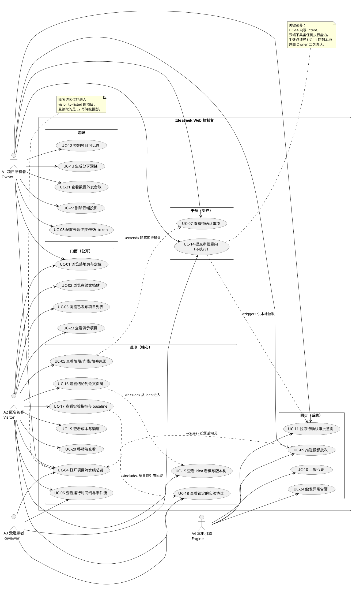
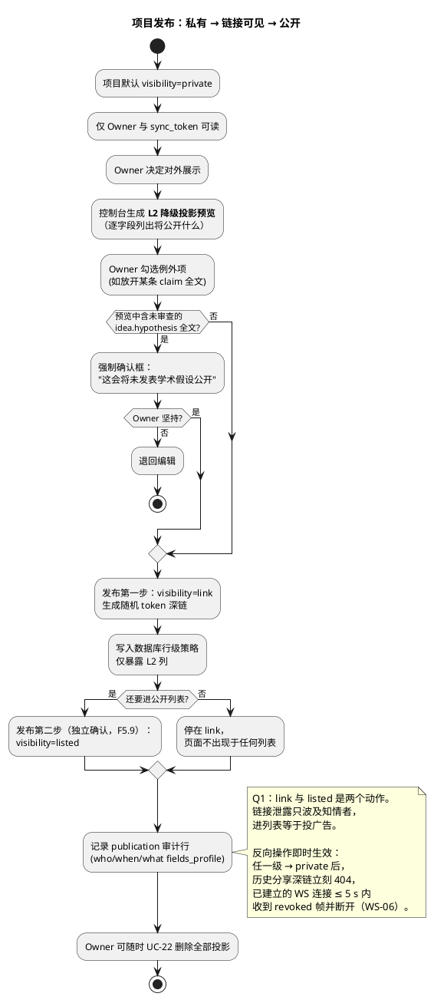
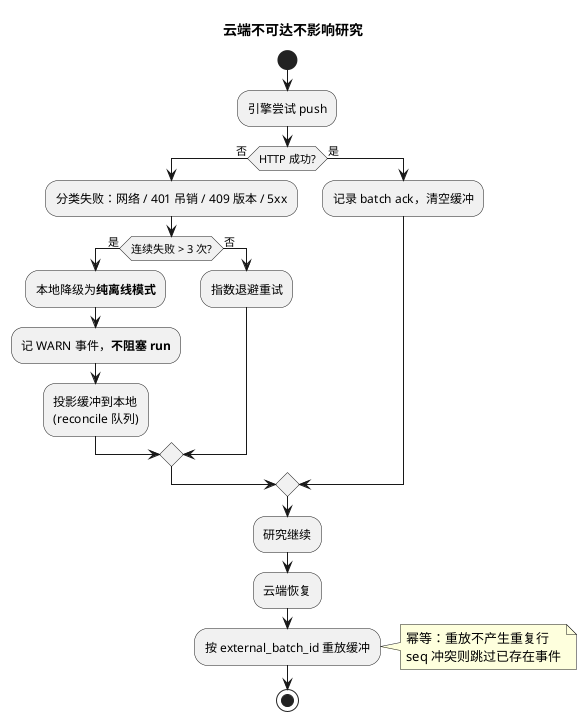

# IdeaSeek Web 控制台 — 用例图 / 流程图 / ER 图

配套：[REQUIREMENTS.md](REQUIREMENTS.md) · [FEATURE_LIST.md](FEATURE_LIST.md) · [PLAN.md](PLAN.md)

> 渲染：全部为 PlantUML，与 `D:\润建\需求五组生产流程.txt` 同一体例。本地按 `bytecoder-v6业务开发流程new.md` 的方式在 Markdown Preview Enhanced 里配置 PlantUML server 即可；gitee/GitHub 网页端不渲染 PlantUML，评审时请在编辑器中打开。

---

## 1. 用例图



---

## 2. 流程图

### 2.1 主流程：长任务远程观测（闭环缺口⑩）

```plantuml
@startuml
title 主流程：离开终端后的只读观测

start
:本地 run 正在执行（数小时~数天）;
:Owner 关闭终端 / 离开承载机;

repeat
  :引擎到达批边界\n或心跳定时器触发;
  :从 SQLite 权威状态\n生成 allowlist 投影;
  note right
    L0 过滤发生在此处，
    序列化之前。
    secret / 论文原文 / 数据内容 /
    完整 prompt / 隐藏推理 一律不出境。
  end note
  :POST /functions/v1/app/ingest\n(Bearer sync_token);

  if (schema 版本受支持?) then (否)
    :整批拒绝 + 回执原因;
    :本地记录失败，投影排队重试;
    :Owner 在 CLI 看到升级提示;
    stop
  else (是)
  endif

  if (校验通过?) then (否)
    :记录 sync_batch.status=rejected;
    :不污染已有投影;
  else (是)
    :按 external_id 幂等 upsert;
    :事务内写 live_outbox\n(带连接内单调 seq);
    :广播 worker 推帧到\n已订阅该项目的 WS 连接\n（state / events）;
    note right
      WS 层不重新查询投影表。
      每批 push 的读次数
      与在线连接数无关（F17.3）。
    end note
  endif
backward
  :继续本地执行\n（云端结果不影响研究）;
repeat while (run 未结束?) is (是)

:Owner 用浏览器打开控制台;
:先 REST 拉全量（首屏）\n再建 WS 订增量;
:看到 阶段 / 阻塞原因 / 待确认事项\n并标注"已同步至 seq N";
stop
@enduml
```

浏览端不轮询：连接断开走指数退避重连，重连成功后**必须先补一次 REST 全量**再收增量帧（WS-03）。S6 判定 Function 不支持长连接时，本图最后两步替换为 15 s 短轮询 + 变更指纹，其余不变。

### 2.2 两阶段审批信箱（约束三，对应 R2）

```plantuml
@startuml
title 审批：云端只记意向，本地才生效

|#LightGray|本地引擎|
start
:run 停在人工门槛\n(autonomy=guided);
:生成 approval_request\nkind ∈ {protocol, decision, repair};
:投影到云端;

|#Lavender|Web 控制台|
:Owner/Reviewer 收到"待确认"提示;
:查看理由、选项、影响范围;
:选择选项 + 填写备注;
:POST /functions/v1/app/approvals/:id/intent;
:落库 approval_intent\n标记 delivered_at;
:界面显示"已提交，待本地确认"\n**不显示"已批准"**;

|#LightGray|本地引擎|
:ideaseek cloud pull;
:取回该 request 的全部 intent;
if (存在互相冲突的 intent?) then (是)
  :全部展示，要求 Owner 裁决;
else (否)
endif
:TUI 二次确认门槛;
if (Owner 确认?) then (否)
  :丢弃 intent，记 RunEvent;
  :按原门槛继续等待;
  stop
else (是)
endif
:写入 Decision + RunEvent;
:从 checkpoint 恢复执行;
:投影 resolved 状态;
stop

note across
  云端全程无执行能力：
  没有 GPU、没有凭据、没有工作流数据库写权限。
  公网写入面 ≠ 远程命令面。
end note
@enduml
```

### 2.3 可见性发布决策（约束一，对应 R1）



### 2.4 断云与恢复（NFR-08）



### 2.5 阶段流水线视图（数据侧状态）

14 阶段直接取 `docs/WORKFLOW_SPEC.md:5-21` 原文，控制台**不得增删或重命名**（NFR-12）：

```text
INIT → INPUT_READY → CALIBRATING → PAPER_ANALYSIS → DATA_READY
     → PROTOCOL_PROPOSED → PROTOCOL_REVIEW → COMPARISON_DISCOVERY
     → COMPARISON_REPRODUCTION → BASELINE_VALIDATED → IDEA_GENERATION
     → IDEA_SCREENING → EXPERIMENTING → IDEA_REVIEW → COMPLETED
```

任意阶段可叠加异常态（`WORKFLOW_SPEC.md:23`）：`PAUSED` / `AUTH_REQUIRED` / `USER_INPUT_REQUIRED` / `NETWORK_BLOCKED` / `QUOTA_EXHAUSTED` / `FAILED_RECOVERABLE` / `CANCELED`。

> **实现注意**：这 14 个阶段目前只存在于规范文档；代码里 `src/workflow/types.ts:40` 的 `RunPhase` 只有 `INIT|DEMO|COMPLETED`，`task.phase` 是自由字符串。投影器必须先建立"规范阶段 ↔ 实际 task.phase"的映射，且在映射不到时显示 `unknown` 而不是猜一个（Q3 的子项，见 PLAN.md 里程碑 2）。

---

## 3. ER 图

云端是**投影库**，不是权威库。命名统一前缀 `cloud_`，与本地 `src/workflow/sqlite.ts:56-223` 的表一一对应但字段更少。

```plantuml
@startuml
title IdeaSeek Web 控制台 — 云端投影 ER（L0 字段一律不存在）
skinparam linetype ortho

entity "cloud_owner" as owner {
  * id : uuid <<PK>>
  --
  email : text
  display_name : text
  created_at : timestamptz
}

entity "cloud_sync_token" as token {
  * id : uuid <<PK>>
  --
  owner_id : uuid <<FK>>
  token_hash : text  "仅存哈希"
  name : text
  scopes : text[]
  project_scope : uuid[] "空=全部"
  last_used_at : timestamptz
  revoked_at : timestamptz
}

entity "cloud_project" as proj {
  * id : uuid <<PK>>
  --
  owner_id : uuid <<FK>>
  external_id : text "本地 project_id"
  title : text
  question : text
  strategy : text "starter|standard|research"
  autonomy : text "guided|autonomous|review-only"
  visibility : text "private|link|listed"
  source_host : text "脱敏主机名"
  schema_version : int
  last_sync_at : timestamptz
  archived_at : timestamptz
}

entity "cloud_run" as run {
  * id : uuid <<PK>>
  --
  project_id : uuid <<FK>>
  external_run_id : text
  status : text "RunStatus 枚举原文"
  phase_tag : text
  started_at : timestamptz
  finished_at : timestamptz
  heartbeat_at : timestamptz
  error_class : text
  summary : text "<=400 字符"
  budget_usd_micro : bigint
  spent_usd_micro : bigint
}

entity "cloud_stage_progress" as stage {
  * id : uuid <<PK>>
  --
  run_id : uuid <<FK>>
  stage : text "14 阶段枚举"
  state : text "pending|active|blocked|passed|failed"
  gate_note : text
  blocker_code : text
  entered_at : timestamptz
  exited_at : timestamptz
}

entity "cloud_task" as task {
  * id : uuid <<PK>>
  --
  run_id : uuid <<FK>>
  external_task_id : text
  kind : text
  agent_role : text
  status : text
  phase_tag : text
  attempt : int
  started_at : timestamptz
  ended_at : timestamptz
  artifact_count : int
}

entity "cloud_run_event" as event {
  * id : uuid <<PK>>
  --
  run_id : uuid <<FK>>
  seq : bigint  "<<UQ>> (run_id, seq)"
  ts : timestamptz
  stage : text
  object_type : text
  object_id : text
  actor_role : text
  type : text
  summary : text "<=400 已脱敏"
  level : text
}

entity "cloud_artifact_ref" as art {
  * id : uuid <<PK>>
  --
  run_id : uuid <<FK>>
  external_artifact_id : text
  kind : text
  path_hint : text "相对，不含绝对路径"
  content_hash : text "sha256"
  size_bytes : bigint
  "正文不入库，仅引用+哈希" : note
}

entity "cloud_paper_card" as paper {
  * id : uuid <<PK>>
  --
  project_id : uuid <<FK>>
  external_paper_id : text
  title : text
  problem : text
  method_summary : text
  status : text "ok|failed|partial"
  parser_version : text
  claim_count : int
  unknown_count : int
}

entity "cloud_claim" as claim {
  * id : uuid <<PK>>
  --
  paper_card_id : uuid <<FK>>
  text : text "L1，默认不公开"
  stance : text
  confidence : text
}

entity "cloud_evidence_ref" as evid {
  * id : uuid <<PK>>
  --
  claim_id : uuid <<FK>>
  page : int
  section : text
  kind : text "不含正文"
}

entity "cloud_protocol" as proto {
  * id : uuid <<PK>>
  --
  project_id : uuid <<FK>>
  external_id : text
  version : int
  status : text "draft|proposed|locked|superseded"
  task_definition : text
  sample_unit : text
  primary_metrics : jsonb
  split_rule : text
  locked_at : timestamptz
}

entity "cloud_comparison" as comp {
  * id : uuid <<PK>>
  --
  project_id : uuid <<FK>>
  external_method_id : text
  name : text
  code_source : text "user|official-code|paper-reimplementation"
  required : bool
  status : text "10 态枚举"
  repro_confidence : text
}

entity "cloud_ideation_round" as round {
  * id : uuid <<PK>>
  --
  project_id : uuid <<FK>>
  external_round_id : text
  index : int
  note : text
  created_at : timestamptz
}

entity "cloud_idea" as idea {
  * id : uuid <<PK>>
  --
  project_id : uuid <<FK>>
  ideation_round_id : uuid <<FK>>
  external_idea_id : text
  title : text
  hypothesis : text "L1 未发表假设"
  mechanism_summary : text
  status : text "8 态枚举"
  parent_idea_id : uuid "<<FK self>>"
  verdict : text "SUPPORTED|NEEDS_REVISION|REJECTED|INVALID_RUN"
}

entity "cloud_experiment" as exp {
  * id : uuid <<PK>>
  --
  idea_id : uuid <<FK>>
  run_id : uuid <<FK>>
  protocol_id : uuid <<FK>>
  external_spec_id : text
  scale : text "smoke|quick|standard|handoff_manifest"
  status : text
  seed : int
  failure_class : text
  started_at : timestamptz
  ended_at : timestamptz
}

entity "cloud_metric_result" as metric {
  * id : uuid <<PK>>
  --
  experiment_id : uuid <<FK>>
  name : text
  value : numeric
  direction : text
  variance : numeric
  is_synthetic : bool "true 禁止当结果展示"
  baseline_comparison_id : uuid
  delta : numeric
}

entity "cloud_approval_request" as areq {
  * id : uuid <<PK>>
  --
  run_id : uuid <<FK>>
  kind : text "protocol|decision|repair"
  summary : text
  options : jsonb
  payload_hash : text
  status : text "pending|resolved|expired"
  created_at : timestamptz
  resolved_at : timestamptz
}

entity "cloud_approval_intent" as aint {
  * id : uuid <<PK>>
  --
  approval_request_id : uuid <<FK>>
  owner_id : uuid <<FK>>
  choice : text
  note : text
  submitted_at : timestamptz
  delivered_at : timestamptz "本地已拉取"
  consumed_at : timestamptz "本地已裁决"
}

entity "cloud_cost_entry" as cost {
  * id : uuid <<PK>>
  --
  run_id : uuid <<FK>>
  ts : timestamptz
  provider_class : text "脱敏，不存凭据"
  model_route : text
  kind : text
  tokens_in : bigint
  tokens_out : bigint
  usd_micro : bigint
  gpu_seconds : bigint
}

entity "cloud_egress_entry" as egress {
  * id : uuid <<PK>>
  --
  run_id : uuid <<FK>>
  ts : timestamptz
  channel : text "model|web|git"
  target_class : text
  object_kind : text
  request_count : int
  bytes_out : bigint "无正文"
}

entity "cloud_publication" as pub {
  * id : uuid <<PK>>
  --
  project_id : uuid <<FK>>
  visibility : text
  share_token : text "仅 link 模式"
  fields_profile : text "standard|redacted"
  published_by : uuid <<FK>>
  published_at : timestamptz
  revoked_at : timestamptz
}

entity "cloud_sync_batch" as batch {
  * id : uuid <<PK>>
  --
  project_id : uuid <<FK>>
  token_id : uuid <<FK>>
  external_batch_id : text "<<UQ>> 幂等键"
  schema_version : int
  entity_counts : jsonb
  rejected_reasons : jsonb
  status : text "accepted|partial|rejected"
  requested_at : timestamptz
}

entity "live_outbox" as outbox {
  * id : bigserial <<PK>>
  --
  project_id : uuid <<FK>>
  batch_id : uuid <<FK>> "来源 push"
  frame_type : text "state|events|revoked"
  payload : jsonb "≤ 8 KB，仅脱敏摘要"
  created_at : timestamptz
  --
  note: 与 upsert 同事务写入，
  广播 worker 消费后即删。
  它是投影表与 WS 之间唯一的耦合点：
  WS 层不直读 cloud_*（F17.3）。
}

owner ||--o{ token
owner ||--o{ proj
token  ||--o{ batch
proj   ||--o{ run
proj   ||--o{ paper
proj   ||--o{ proto
proj   ||--o{ comp
proj   ||--o{ round
proj   ||--o{ idea
proj   ||--o| pub
proj   ||--o{ batch
batch  ||--o{ outbox
proj   ||--o{ outbox
run    ||--o{ stage
run    ||--o{ task
run    ||--o{ event
run    ||--o{ art
run    ||--o{ cost
run    ||--o{ egress
run    ||--o{ areq
paper  ||--o{ claim
claim  ||--o{ evid
round  ||--o{ idea
idea   ||--o{ idea : parent_idea_id
idea   ||--o{ exp
proto  ||--o{ exp
exp    ||--o{ metric
areq   ||--o{ aint
owner  ||--o{ aint

note bottom of batch
  幂等与可观测性的落点：
  每个 sync_batch 是一次可追溯的
  投影事务，失败整批不污染既有行。
end note

note right of idea
  hypothesis 是未发表学术成果。
  visibility≠private 时默认走
  redacted profile，只露 title/status。
end note

note bottom of metric
  is_synthetic=true 的行
  在任何视图都不得渲染为结果（NFR-13）。
end note
@enduml
```



### 3.1 与本地权威库的映射

| 云端投影 | 本地来源（`src/workflow/sqlite.ts:56-223`） | 降级说明 |
| --- | --- | --- |
| `cloud_project` | `project` | 去掉绝对路径 |
| `cloud_run` | `run` | 去掉完整 config 快照，留 hash |
| `cloud_task` | `task` | 去掉 log 正文 |
| `cloud_run_event` | `run_event` | 摘要截断，已脱敏 |
| `cloud_artifact_ref` | `artifact` | **只留引用 + hash，正文不出境** |
| `cloud_paper_card` / `claim` / `evidence_ref` | `paper_index` + PaperCard JSON | 全文与 PDF 内容不出境，只留定位 |
| `cloud_protocol` | `protocol_lock` | 去掉本地路径 |
| `cloud_comparison` | `comparison` | 去掉 upstream URL 中的凭据痕迹 |
| `cloud_experiment` / `metric_result` | `experiment` + RunResult | `handoff_manifest` 标注为"未执行" |
| `worker` / `research_node` / `schema_version` | 同名表 | **不投影**，运维细节无观测价值 |

---

## 4. 图示层面的残留风险

评审已通过（`REQUIREMENTS.md §8.1`），以下三条是图示本身仍带着的已知不确定性，开发时按此处理，不当作错误：

1. `cloud_egress_entry` 依赖本地先产出外发计数（缺口⑫本身未实现）。若里程碑 6 时该能力仍缺，UC-21 降级为"仅展示模型调用计数"或推迟。
2. `cloud_stage_progress.stage` 需要 14 阶段映射表，映射不上的 `task.phase` 归入 `unknown` 并**显式可视化**，让规范与实现的差距可见，而不是藏起来。
3. §2.1 的 WS 推帧分支画的是"平台支持长连接"这一**未验证前提**（spike S6）。S6 判定不通时，该分支替换为 15 s 短轮询 + 变更指纹，`live_outbox` 仍然成立（变更指纹从它派生），本图其余部分不动。
