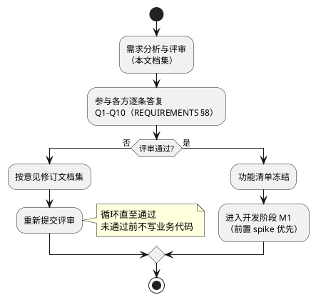

# IdeaSeek Web 控制台 — 技术栈、生产周期与执行计划

本文档同时覆盖 `todolist.md` 两道工序的产出物：

- **工期测算** → 初步功能清单（= [FEATURE_LIST.md](FEATURE_LIST.md) 的 P0 42 项裁剪）、生产周期（§4）、执行计划（§5）
- **需求分析与评审** → 技术栈（§1–§2）、原型设计文档（§6）

配套：[REQUIREMENTS.md](REQUIREMENTS.md) · [DIAGRAMS.md](DIAGRAMS.md)

---

## 1. 技术栈选型

选择原则：**不扩大根工程依赖面、不依赖任何第三方 CDN、构建产物必须是一份可静态打包的目录**。IdeaSeek 主线的 219 个测试文件和 `release-check` 门禁不能被前端依赖污染。

| 层 | 选型 | 理由 | 被否掉的方向 |
| --- | --- | --- | --- |
| 语言 | TypeScript 6 | 与根 `typescript ^6.0.3` 同版本，共享类型与 lint 规则 | — |
| 视图 | React 19 + 函数组件 | 根 `package.json:48` 已有 `react 19.1.10`，不引入第二份 React | Vue（与既有依赖重复） |
| 构建 | Vite | 产物为纯静态目录，正好匹配 Sites 的"打包上传静态站"模型 | Webpack（配置面大）；Next SSR（Sites 是静态托管 + Function，不是 Node 常驻服务） |
| 路由 | **hash 路由**（`wouter`） | 现有 `docs/site/index.html` 已用 hash 锚点导航，说明该仓库在无服务端 rewrite 的条件下也能工作；Sites 是否提供 SPA fallback 未验证 | History API 路由——若托管不做 404→index 回退，深链直接白屏 |
| 样式 | 纯 CSS + 设计令牌（CSS 变量） | 零 PostCSS 依赖，构建风险最低；控制台页面类型约 10 种，手写可控 | Tailwind（引入 PostCSS，叠加 S1 spike 未验证风险） |
| 数据 | `@tanstack/react-query` | 投影是批更新，天然需要轮询 + 缓存 + 陈旧标记 | 手写 fetch（重复造轮子）；SWR（缓存语义更弱） |
| 图表 | 自绘 SVG | 阶段流水线、指标条、版本树形状固定，不需要通用图表库 | ECharts（体积与字体风险） |
| Schema | ajv 8（`package.json:45` 已有） | Function 侧校验投影契约，与本地 40+ schema 同一套惯例 | zod（新增依赖且与既有契约体系并行） |
| 后端 | Sites Functions（Node） | 平台自带托管，含 `function_backend` | Cloudflare Workers（用户已选 Sites） |
| 数据库 | Sites 托管关系库（JSONB 支持，推断为 Postgres） | 平台 API 明示 bigint/JSONB 精度语义 | 自建库（无托管入口） |
| 测试 | vitest 4（已有） | Function 单测 + 投影器单测与主线同框架 | — |

**待 spike 推翻的可能**：见 §3。任何一项被推翻，只影响 §2 目录布局，不影响需求与 ER 设计。

---

## 2. 工程布局

```
ideaseek/                          (branch: feat/web-console)
├─ src/                            ← 主线 CLI，只新增 cloud 命令组
│  ├─ commands/cloud.ts            [新] link/push/pull/status/disable
│  ├─ cloud/                       [新] 投影器
│  │  ├─ projector.ts              SQLite → 实体投影
│  │  ├─ redact.ts                 L0 脱敏（安全边界本体）
│  │  ├─ allowlist.ts              字段白名单，编译期穷举
│  │  ├─ buffer.ts                 离线队列与重放
│  │  └─ client.ts                 HTTP + 重试 + 版本协商
│  └─ core/schema/schemas/cloud-projection-v1.json   [新]
│
├─ web/console/                    ← 与主线隔离的前端子工程
│  ├─ package.json                 独立 lockfile，不进根 pnpm install
│  ├─ vite.config.ts
│  ├─ src/                         页面与组件
│  └─ dist/                        构建产物（prepare_site 上传这个）
│
├─ web/functions/                  ← Sites Function
│  ├─ index.ts                     路由 /api/ingest /api/views/* /api/approvals/*
│  ├─ ingest.ts                    校验 + 幂等 upsert
│  ├─ policy.ts                    可见性 → 行列过滤
│  └─ schema.ts                    由 cloud-projection-v1.json 生成的类型
│
├─ web/migrations/                 ← cloud_* 建表（受管 DDL）
├─ web/fixtures/demo-project/      ← 合成演示投影（F7.1）
└─ docs/web-console/               ← 本目录
```

**隔离要求（必须落实，否则破坏主线门禁）**：

1. `web/console/node_modules` 与 `web/functions/node_modules` 加入 `.gitignore`。
2. 根 `tsconfig.json` / `tsconfig.build.json` **不包含** `web/**`；前端单独 tsconfig。
3. `eslint.config.js` 与 `.prettierignore` 显式处理 `web/**`（前端不跑 node-pty/ink 相关规则）。
4. `pnpm test` 与 `pnpm release-check` 在加入 `web/` 后必须仍然全绿——这是合并前置条件。
5. `web/` 不引入 `allowBuilds` 之外的带构建脚本依赖（`pnpm-workspace.yaml`），避免改动主线安装白名单。

> 注意：`pnpm-workspace.yaml` 目前**只有 `allowBuilds` 映射、没有 `packages:` 字段**，也就是说本仓库并不是真正的多包 workspace。`web/console` 用独立安装而非 workspace 包，正是为了不改动这一构建语义。

---

## 3. 前置 Spike（里程碑 1 第一件事，阻塞全局）

平台侧关于 Sites Function 的运行时细节没有本地文档可查（本次调研已确认），因此以下 5 问必须在写业务代码前用最小骨架验证。**R4 的缓解措施就是这个 spike 本身。**

| ID | 待验证 | 不通时的降级方案 |
| --- | --- | --- |
| S1 | Function 运行时是 Node 还是受限边缘沙箱？有无 `fetch`/`crypto`/超时上限？ | 若受限，投影校验逻辑移到前端预生成 + 构建期脚本 |
| S2 | Function 能否访问托管数据库并执行受管迁移？ | 若不能，退回"构建期把投影烤成静态 JSON"，控制台变纯静态站 |
| S3 | 静态托管是否支持未命中路径回退 `index.html` | 已用 hash 路由规避，无需降级 |
| S4 | 单次请求体上限与写入频率限制 | 决定 push 批大小与心跳间隔；上限很小则按实体分表多次提交 |
| S5 | 行级/列级访问策略能否表达"public 只读 L2 列" | 若只能表级，则**再降级投影物理分表**（`cloud_public_*` 视图），安全等价 |

**Spike 通过标准**：本地 `ideaseek` 把一条伪造投影推到云端库，浏览器 hash 深链能读到，且匿名角色读不到敏感列。做到即判定技术栈成立。

---

## 4. 生产周期（工期测算产出物）

前提：单人 + Agent 辅助；不含需求评审等待；估算单位为人日（1 人日 = 有效 6h）。

| 里程碑 | 内容 | 人日 | 前置 | 出口门禁 |
| --- | --- | :-: | --- | --- |
| **M0** | 需求评审（本文档集）+ Q1–Q10 答复 | 1.0 | — | 十问有结论，功能清单冻结 |
| **M1** | Spike S1–S5 + 工程骨架 + `cloud_*` 建表 + 投影契约 | 2.5 | M0 | spike 报告；主线 `pnpm test` 仍全绿 |
| **M2** | 同步链路：`cloud link/push`、脱敏、幂等、版本协商、离线缓冲 | 3.5 | M1 | F1.1–F1.11 单测过；20 种 secret fixture 0 泄漏 |
| **M3** | 核心观测 UI：项目/运行/流水线/事件流 | 4.0 | M2 | F2.1–F2.5, F3.1–F3.4, F4.1–F4.4 |
| **M4** | 可见性 + 落地页 + 文档站 + 演示数据 + 移动适配 | 3.0 | M3 | **42 项 P0 全绿**；开放公开访问 |
| **M5** | 深视图：idea 看板/版本树、证据链、实验与协议 | 4.0 | M4 | F8/F9/F10 的 P1 项 |
| **M6** | 审批信箱 + 成本 + 外发台账 + token 管理 | 3.5 | M5 | F11/F12/F16 的 P1 项 |
| **M7** | 硬化：真实长任务联调、schema 漂移演练、验收与文档 | 2.0 | M6 | `USER_JOURNEY` 补一节控制台验收 |

```
净工时 23.5 人日
含 25% 不确定性缓冲 ≈ 29.4 人日
单人串行 ≈ 6 周（每周 5 天）
双人并行（M3/M4/M5 前后端拆分）≈ 3.5 周
```

**风险敞口**：M1 spike 若判定 S2 不通（Function 不能连库），M2 之后整体重排为"构建期静态投影"，工期减约 4 人日但失去在线推送能力，需重新评审产品定位。这是唯一会改变项目形态的风险。

---

## 5. 执行计划

### 5.1 分支与提交

- 全部在 `feat/web-console`（已创建）；按仓库 `GIT_WORKFLOW.md` 不直推 `main`。
- 每个里程碑内按垂直切片小提交：`feat(console): ...` / `fix(cloud): ...` / `docs(web-console): ...`。
- 每切片结束：目标测试 → `pnpm test`（主线不受损证明）→ 更新 `docs/PROGRESS.md` → commit。

### 5.2 每里程碑的"可演示物"

| 里程碑 | 结束时能给评审看什么 |
| --- | --- |
| M1 | 一个空壳页面 + 一条真实数据从 CLI 到库到浏览器的证据 |
| M2 | 终端敲 `ideaseek cloud push` 后网页出现项目 |
| M3 | 长任务跑到哪一步、卡在哪，手机可看 |
| M4 | **公开链接 + 演示项目 + 落地页**（第一次真实对外） |
| M5 | 点一个结论跳到论文页码 |
| M6 | 网页提交审批意向 → 本地 `pull` 看到它 |

### 5.3 公开上线的强制检查单（M4 出口）

必须逐项打勾才能 `update_access_policy(public)`：

- [ ] F5.2 L2 再降级投影在**数据库层**生效（用匿名身份实测，不是看前端）
- [ ] F1.4 脱敏单测 0 泄漏，且新增 secret 样本仍失败即报警
- [ ] F7.1 演示项目确认为合成数据，无任何真实论文/数据/凭据痕迹
- [ ] F5.6 public→private 撤销后旧深链实测 404
- [ ] 全站文案扫描无"实时"（R3）
- [ ] `is_synthetic` 指标在界面上未被当作结果（NFR-13）
- [ ] 未回答的 Q1/Q2 已按建议结论落文档

**这份清单是需求的一部分，不是运维习惯。** 公开访问一旦开放，R1 造成的泄露不可撤销。

### 5.4 依赖与阻塞

| 依赖 | 影响 | 处置 |
| --- | --- | --- |
| Q3 未批准改 CLI | M2 无法做在线推送，只能人工导 JSON | **M0 必须先答** |
| 缺口⑫ 未实现 | M13 台账无数据源 | 标 P2，可整体推迟 |
| Sites 平台细节未知 | S1/S2/S4 | 前置 spike |

> 已排除的一项担忧：我起初按 `PRODUCT_GAPS_AUDIT.md:84` 认为步骤级事件未接线、控制台只能做任务级。核对代码后确认缺口⑨ **已于 2026-11-14 收口**（`f2a23eb`，`PROGRESS.md:445`），因此 F4.7 步骤级视图可直接排进 M5，不需等引擎。教训：**过期审计文档不能代替代码验证**——见 Q10。

---

## 6. 原型设计文档（产出物 6 的设计部分）

代码在 M3–M4 产出；此处为可评审的原型设计基准。

### 6.1 视觉基调

沿用 IdeaSeek 终端气质：深色为默认、等宽字体用于 ID/枚举、状态色只用于"阶段与结论"两类语义。无外部字体、无 CDN。

设计令牌：

```css
--bg: #0d1117; --panel: #161b22; --line: #30363d;
--text: #e6edf3; --muted: #8b949e;
--ok: #3fb950; --active: #58a6ff; --blocked: #d29922;
--fail: #f85149; --quota: #a371f7;   /* 额度耗尽 ≠ 失败 */
```

`--quota` 与 `--fail` 必须不同色且带文字标签——这是 F2.4 的视觉落点，也是整份设计里最重要的一处区分。

### 6.2 页面清单与线框

**P1 落地页**（匿名）

```
┌────────────────────────────────────────────┐
│  IdeaSeek   从研究问题，到可验证发现          │
│  ─ 证据链 · 恢复语义 · 公平性锁定 · 审计门禁  │
│  [ 查看演示项目 ]  [ 阅读文档 ]  [ 部署到本地 ]│
├────────────────────────────────────────────┤
│  在线项目： ┌────┐ ┌────┐ ┌────┐            │
│            │演示 │ │发布 │ │…   │            │
├────────────────────────────────────────────┤
│  与"单 Agent 直接写论文"的三条差异            │
│  引擎在哪里跑：本地，云端不碰你的论文和数据     │
└────────────────────────────────────────────┘
```

关键：必须有一屏说明**"科研引擎运行在你自己的机器上，云端只有脱敏进度投影"**。这是缺口⑩ 产品的正当性来源，也是对 R1 质疑的正面回答。

**P2 项目总览**（核心屏）

```
┌────────────────────────────────────────────────┐
│ ← 项目列表   持续学习中的灾难性遗忘   [私有 ●]  │
│ 最后同步 4 分钟前 · strategy=research · guided   │
├────────────────────────────────────────────────┤
│ INIT─INPUT─CALIB─PAPER─DATA─PROTO─┐            │
│  ✓     ✓      ✓     ✓     ✓    ●──┴─COMPARISON │
│                                    …COMPLETED   │
│  ┌── 当前阶段：PROTOCOL_REVIEW ──────────────┐  │
│  │ 状态：需要你确认                          │  │
│  │ 原因：样本单位与泄漏边界存在两种解释        │  │
│  │ 建议：查看 3 个候选协议 →                  │  │
│  └───────────────────────────────────────────┘  │
│  [时间线] [Ideas 7] [论文 42] [成本] [审批 1]   │
└────────────────────────────────────────────────┘
```

首屏回答三件事：**跑到哪、卡在哪、要我做什么**。对应 `PRODUCT_GAPS_AUDIT.md:108` 的产品验收原则。

**P3 时间线**：左侧过滤（阶段/角色/类型），右侧事件流，批次分隔线标注"↑ 同步于 12:04"。

**P4 Idea 看板**：按状态分列，`DRAFT_COMPOSITION` 单独一列且灰显，不与有效候选混排。

**P5 证据追溯**：`idea → claim（含出处）→ paper card → page N`，面包屑可反跳。

**P6 审批**：卡片 + 选项大按钮 + 固定底部黄条：**"提交仅记录意向，需在本地 `ideaseek cloud pull` 后二次确认方生效。"**

**P7 成本**：预算进度条、按路由分布、重复成本标记。

**P8 设置**：token 列表（名称/范围/最后使用/吊销）、可见性开关与发布预览。

### 6.3 移动端裁剪

360px 下：阶段图转横向滚动条；卡片单列；"要我做什么"常驻首屏顶部；表格转键值卡。

---

## 7. 评审流程

按 `todolist.md:38-44` 的循环，本文档集进入评审：



**评审需要产出的结论**：§8 八个开放问题的逐条答复 + 对约束一~四的认可。

---

## 8. 本阶段自检

| 检查 | 结果 |
| --- | --- |
| 是否重复实现了 `main` 已有能力 | 否。`cloud` 命令组不存在（`src/commands/` 62 个命令无 cloud） |
| 是否把文档当成功能 | 否。本阶段只交付文档，未打任何 PROGRESS 勾 |
| 是否存在未标注的臆测 | 平台运行时细节标为 S1–S5 待验证；14 阶段与代码不符已标出。**一处臆测已自纠**：我最初照 `PRODUCT_GAPS_AUDIT.md:84` 判定缺口⑨未实现并据此压低 SLA，核对 `usage-recorder.ts:116`、`progress-events.ts:51`、`tests/step-visibility.test.ts` 与 `PROGRESS.md:445`（`f2a23eb`）后确认已收口，F4.7 与 §3.4 已改写 |
| 是否声称跑过门禁 | 否。本轮纯 Markdown，`node_modules` 未安装，未运行 `pnpm test`；`.prettierignore` 含 `**/*.md`，仓库文档本就不入格式门禁 |
| 是否回避了核心矛盾 | 未回避。公开访问 vs 私有数据（§3.1）、审批 vs 远程执行（§3.3）为本产品两大真实冲突 |
| 主线门禁是否受保护 | §2 隔离要求 + M1 出口门禁"主线测试仍全绿" |
